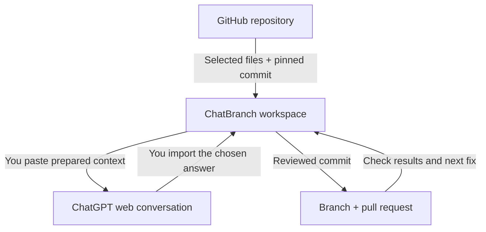

<!-- <p align="center">
  
</p> -->

<h1 align="center">ChatBranch</h1>

<p align="center">
  <strong>Turn code from ChatGPT into GitHub pull requests you can review, test, and improve.</strong>
</p>

<p align="center">
  Chrome extension · Manifest V3 · Public repositories · MIT licensed<br>
  <strong>v0.2.0 · Public alpha</strong>
</p>

<p align="center">
  <a href="#quick-start">Get started</a> ·
  <a href="#the-workflow">How it works</a> ·
  <a href="#try-the-demo">Try the demo</a> ·
  <a href="#security-and-permissions">Security</a> ·
  <a href="docs/ARCHITECTURE.md">Architecture</a>
</p>

---

A useful answer in chat still needs to become real files, a branch, a reviewed diff, and a pull request. Then the tests need to run, and failures need another pass.

**ChatBranch connects that workflow.** Select files from a GitHub repository, bring their context into your ChatGPT conversation, import the response, review the changes, and publish a PR. If checks fail, bring the results back into the conversation and update the same PR.

It uses your existing ChatGPT web conversation and talks directly to GitHub. **No model API key, application server, terminal bridge, or extension build step is required.** You choose what to share and when to publish.

## What you can do

| Capability | What it means in practice |
| --- | --- |
| **Bring the right context** | Select source files, tests, and repo instructions. Copy a prompt tied to an exact commit. |
| **Capture an answer** | Click **Send to ChatBranch** on a ChatGPT response, paste it manually, or import complete text files. |
| **Review the actual change** | Inspect destination paths, additions, and deletions before publishing. |
| **Create a contribution** | Put the reviewed files in one commit on a new branch and open a draft or regular PR. |
| **Contribute through a fork** | Create or reuse your fork when you do not have push access to the selected public repository. |
| **Keep working on one PR** | Read check results, load the PR branch, and publish a reviewed fix to that branch. |
| **Keep your sign-in** | Reuse the saved GitHub credential and verify the account automatically after reopening. |

**Current release:** a development build loaded unpacked in Chrome, not a Chrome Web Store release. Public GitHub.com repositories are supported; private repositories and GitHub Enterprise are outside this version's scope. See [validation](#validation) for what has been tested.

## Quick start

You need **Chrome 120 or newer**, access to ChatGPT in your browser, and a GitHub account for publishing. Node.js is only needed to develop and test ChatBranch itself.

### 1. Load the extension

1. Download or clone this project. If you downloaded a ZIP, extract it and keep the extracted folder.
2. Open `chrome://extensions` and enable **Developer mode**.
3. Choose **Load unpacked** and select the project's **`extension/` folder**, which contains `manifest.json`. In the distributed ZIP, this is `chatbranch/extension/`.
4. Pin ChatBranch and click its toolbar icon. Use the side panel or choose **Expand** for the full workspace.
5. Reload an existing `chatgpt.com` tab to enable **Send to ChatBranch** on assistant responses.

You can already load public repositories and copy selected file context before signing in.

### 2. Connect GitHub

This alpha uses a GitHub OAuth app that you register once. Register an **OAuth App**, not a GitHub App.

| GitHub OAuth setting | Value |
| --- | --- |
| Application name | `ChatBranch` |
| Homepage URL | `https://github.com` |
| Authorization callback URL | `https://github.com` |
| Device Flow | **Enabled** |

The device flow does not use the callback URL, but GitHub's registration form requires one.

1. [Register the OAuth app](https://github.com/settings/applications/new) and enable **Device Flow** in its settings.
2. Copy its public **Client ID** into ChatBranch's **GitHub setup** section. No client secret is needed.
3. Leave workflow access off for ordinary source and test edits. Enable it if you intend to add or modify `.github/workflows/` files.
4. Choose **Save setup**, then **Sign in**. Follow **Continue on GitHub**, enter the displayed device code, and authorize the app.
5. Look for **API: reachable** and **Account: verified @yourname**, then load your repository.

The saved credential is reused on this Chrome profile. Reopening the workspace does not normally require another device code. Expired or revoked credentials, signing out, and additional permissions can require authorization again.

See the [complete OAuth guide](docs/OAUTH_SETUP.md) for setup, permissions, and troubleshooting. People installing this alpha should register their own app and enter their own client ID; a shared product OAuth registration has not been shipped.

## The workflow

### 1. Give ChatGPT the right files

Enter `owner/repo` or a public GitHub repository URL, leave **Base branch** blank to use its default branch, and click **Load repo**.

Select the relevant source files, their tests, `README.md`, and any `AGENTS.md` or contributor instructions. Describe the behavior you want and choose **Copy prompt + files**. Paste that prompt into your ChatGPT conversation.

The prompt includes the repository, branch, exact base commit, selected file contents, and the expected response format. ChatGPT receives the files you choose to paste into the conversation; ChatBranch does not automatically submit the prompt.

### 2. Bring the answer back

Choose **Send to ChatBranch** on the response, or paste it into ChatBranch's response box. Complete text-file and folder imports are also supported; confirm their destination paths before review.

The recommended response is a **JSON change bundle** containing full replacement files and explicit deletions. Ordinary unified diffs and file-labelled Markdown blocks also work. See [import formats](#import-formats).

### 3. Review before publishing

Click **Review changes** and read the file paths and diff. Check the code, tests, and any workflow changes. Importing an answer alone does not publish it.

Enter the PR title, new branch name, commit message, and description. Check **I reviewed the file paths, diff, tests and workflow changes** when you have done that review.

**Create as a draft PR** is selected by default. Keep it selected while the work is in progress, or clear it when the contribution is ready for review. Then choose **Publish branch + pull request**.

With push access, ChatBranch creates the branch in the selected repository. Otherwise, it creates or reuses your fork and opens the PR against the selected upstream repository and base branch.

### 4. Follow the tests

After publishing, choose **Refresh checks**. ChatBranch reads the checks configured in the repository for the PR's current commit. Refresh manually to get updates.

| Result | Meaning |
| --- | --- |
| **No checks** | No checks were found. This is not a passing test result. |
| **In progress** | Checks are queued, running, or waiting for approval. |
| **Checks passed** | Available results succeeded; some checks may have been skipped. Review the actual coverage. |
| **Checks failed** | At least one check failed or was cancelled. Open its logs. |
| **Skipped** | All available checks were skipped or neutral. |
| **Incomplete** | Some results could not be read or the result limit was exceeded. Verify on GitHub. |

The repository needs a CI workflow or another check provider for results to appear. ChatBranch does not automatically create a test suite, configure CI, or run generated code in Chrome. Fork checks can require maintainer approval. Deployment is configured separately in the repository.

### 5. Fix the same PR

1. Open the failing check on GitHub and read the full job log.
2. Choose **Copy results for ChatGPT**. It copies summaries and links; include the relevant log output when the summary is insufficient.
3. Choose **Load PR branch to fix** and select fresh source and test files.
4. Copy the new context into ChatGPT, obtain a corrected bundle, and review it in ChatBranch.
5. Publish the fix to the existing PR branch, then refresh its checks again.

Updates are fast-forward only. Merging remains a separate decision on GitHub.

## Try the demo

The included [JavaScript cart project](sample/README.md) gives you a concrete first contribution to make.

1. Create a public demo repository you own.
2. Upload the **contents of `sample/`** into its root, including `.github/workflows/ci.yml`. Include that folder even if your file picker hides it. Do not upload the outer ChatBranch project as the demo.
3. Load the demo repo in ChatBranch and select `src/cart.js`, `test/cart.test.js`, `package.json`, and `README.md`.
4. Enter this task, then copy the prepared prompt into ChatGPT:

   > Reject negative or unsafe integer prices and quantities. Reject totals that overflow JavaScript's safe integer range. Keep zero valid. Add regression tests and preserve the existing tests.

5. Import the answer, review it, and create a draft PR.
6. Refresh the checks and open the workflow run on GitHub.

The original three tests pass even though the cart has a documented validation bug. A good fix adds tests that expose that bug and verifies the corrected behavior.

For a known correction, paste [examples/cart-fix.json](examples/cart-fix.json) into the response box and review it against the sample. That example intentionally omits `baseCommit` because your demo repository's initial commit will differ. Prompts copied from a real repo include its actual SHA.

The sample workflow runs tests and builds an ESM bundle. Successful pushes to the demo's default branch also deliver a downloadable **`cart-bundle`** artifact. That demonstrates CI and delivery of a tested build; hosting deployment needs an actual deployment target.

## Import formats

A single JSON bundle is the recommended format:

```json
{
  "schemaVersion": 1,
  "baseCommit": "aaaaaaaaaaaaaaaaaaaaaaaaaaaaaaaaaaaaaaaa",
  "summary": "Add a greeting and remove an obsolete file",
  "files": [
    {
      "path": "src/greeting.js",
      "action": "write",
      "content": "export const greeting = 'Hello, world!';\n"
    },
    {
      "path": "src/obsolete.js",
      "action": "delete"
    }
  ]
}
```

Replace the example SHA with the real `baseCommit` in **Copy prompt + files**. A write contains the **entire replacement file**, including its final newline when appropriate. A deletion omits `content`. A partial snippet is not a complete file.

<details>
<summary><strong>Other supported formats and import limits</strong></summary>

- **Unified text diffs:** hunks must match exactly; no fuzzy application occurs.
- **File-labelled Markdown:** precede a complete code block with an explicit heading such as **File: `src/greeting.js`**.
- **One complete file:** enter its destination path when importing unlabelled content.
- **Text-file or folder upload:** choose the files to change and confirm each destination. Folder imports remove the selected top-level folder name.
- **Text renames:** use an explicit deletion and write. Binary and rename-only patches are unsupported.

| Limit | Current value |
| --- | --- |
| Changed files | 50 per import |
| File size | 512 KiB per UTF-8 text file |
| Import or copied context | 3 MiB |
| Selected context files | 25 |
| Repository tree | Non-truncated trees up to 15,000 entries / 1.5 MB metadata |
| Diff preview | 2,000 lines; complete original and proposed files remain available underneath |

Chrome's session storage budget can further limit large reviews. Split a contribution into smaller changes when asked. Symlinks, submodules, Git metadata, common secret paths, and binary file edits are unsupported.

</details>

## Security and permissions

### Changes stay tied to the reviewed commit

ChatBranch reads selected files by their Git object SHA. A bundle from a different base commit is rejected. Publishing checks that the loaded branch still points to the reviewed commit; if it moved, load fresh context and review again.

Only the reviewed changes enter the commit. The existing base tree preserves unrelated files. New contributions use a new branch; publishing directly to the default or loaded base branch is disabled. Existing PR updates use `force: false`.

If publishing is interrupted after branch creation, the current session keeps a checkpoint and comparison link so the PR step can be retried without duplicating the authored commit. A browser restart clears those checkpoints; use GitHub's comparison page or start with a new branch when needed.

### GitHub access is explicit

| Scope | Used for |
| --- | --- |
| `public_repo` | Public-repository branches, commits, forks, and pull requests |
| Optional `workflow` | Adding or modifying GitHub Actions workflow files |

These OAuth scopes cover public repositories across the account; they are broader than access to a single selected repo. The workspace chooses the destination for each operation. Workflow access does not configure deployment secrets or administer branch protection.

### Credentials stay in the extension

The OAuth credential and client ID are saved in `chrome.storage.local` on your Chrome profile. Storage access is restricted to trusted extension contexts before credentials are used. This storage persists across restarts; it is **not an encrypted OS credential vault**.

Tokens do not enter copied prompts, the panel's application state, or content-script messages. The ChatGPT content script captures only the response you explicitly click and cannot request authenticated repository reads or writes. ChatBranch's own network requests go to GitHub's API and OAuth endpoints; it has no application backend or analytics service.

**Sign out** removes the saved credential from Chrome. To revoke the authorization on GitHub too, use [Authorized OAuth Apps](https://github.com/settings/applications). See [architecture](docs/ARCHITECTURE.md) for the complete data flow and trust boundaries.

## Under the hood



The extension is plain JavaScript with a Manifest V3 service worker. The side panel and expanded workspace share the same UI. The worker handles OAuth, immutable reviews, GitHub API operations, and check aggregation. It creates commits with GitHub's Git database API rather than executing shell commands.

Read the [architecture guide](docs/ARCHITECTURE.md) for module responsibilities, fork handling, interrupted publishing, and PR updates.

## Troubleshooting

| What you see | What to do |
| --- | --- |
| **API reachable + Account verified** | Load the intended repo and continue. The account timestamp records its last successful verification. |
| **API reachable + Account signed out** | Public file browsing works. Sign in before reviewing and publishing, then reload the repo. |
| **Chrome permission required** | Choose **Allow GitHub access** and restore access to the two GitHub sites. |
| **API failure + sign-in saved** | Keep the saved sign-in. Use **Open API test**, check network/site access, then **Check connection**. |
| **Sign in again** | GitHub rejected the credential or it expired. Authorize again. |
| **Workflow access missing** | Enable the workflow checkbox, save, choose **Add workflow access**, then reload and review. |
| **No checks** | Confirm the repository has a workflow or another check provider. This does not mean tests passed. |
| **Base commit changed** | Load fresh repository context and regenerate or re-review the change. |
| **Fork is preparing** | Wait briefly, then retry once GitHub has made the selected commit available. |

**Copy diagnostics** produces a report with extension version, connection state, selected repository, and the current error, excluding tokens and source contents. A temporary API failure preserves the saved credential. Successful account checks are cached for up to five minutes and repeated automatically when needed.

<details>
<summary><strong>Updating an existing unpacked installation</strong></summary>

Replace the files in the **same extension folder you originally loaded**, then click **Reload** in `chrome://extensions`. Close and reopen the workspace, and reload the ChatGPT tab.

Keeping the folder path preserves the extension ID and its saved settings. Version 0.2.0 remembers new sign-ins across extension reloads and browser restarts. After upgrading from 0.1.x, sign in once if the old temporary credential has already cleared. Snapshots and reviews are session-only, so reload the repo after an extension restart.

</details>

<details>
<summary><strong>ChatGPT accounts, quotas, and browser support</strong></summary>

ChatBranch uses the ChatGPT web interface you already have access to. It does not change your plan, message limits, workspace permissions, or access to other coding tools. There is no automatic prompt submission or background agent loop.

The capture integration targets `chatgpt.com`; changes to that site's UI can affect its buttons. Manual paste and complete text-file imports are available independently. Other chat providers and browsers have not been validated for this release.

</details>

## Validation

The automated suite contains **44 tests** covering file imports, exact patches, OAuth behavior, credential persistence, repository loading, forks, publishing recovery, PR updates, check aggregation, and panel behavior. Chrome and GitHub responses are mocked in these tests.

The included sample also has three original tests. Its known correction adds five regression tests that fail against the original bug and pass after the fix.

**Real Chrome rendering, live OAuth, live GitHub writes, and hosted Actions were not validated in the build environment.** An optional browser smoke script and a live acceptance checklist are provided in [docs/TESTING.md](docs/TESTING.md). Automated fixtures are not a claim of completed end-to-end validation.

## Development

Use **Node.js 22 or newer**. The extension runtime and its default automated tests have no third-party dependencies.

```sh
# Extension tests and static checks
npm test
npm run check

# Included demo tests and build
npm test --prefix sample
npm run build --prefix sample
```

The optional browser smoke test has separate Playwright/Chromium requirements described in the [testing guide](docs/TESTING.md). After editing extension files, reload the unpacked extension, reopen the workspace, and reload your ChatGPT tab.

### Contributing

Start with an issue or a focused PR explaining the problem, the resulting behavior, and how you checked it. Include meaningful regression tests for behavioral changes. Use fake API responses in automated tests, keep secrets out of fixtures, and preserve the explicit review step and fast-forward publishing rules.

Useful contributions include real-browser compatibility reports, clearer setup and diagnostics, import edge cases, accessibility improvements, and reproducible tests for GitHub workflow behavior. Include the extension version and redacted diagnostics when reporting a connection problem.

## Project notes

Created by [Gael Carrillo Torres](https://github.com/GaelCT).

Released under the [MIT License](LICENSE). ChatBranch is an independent project, not affiliated with OpenAI or GitHub.

**Bring the context. Review the change. Make the contribution.**
